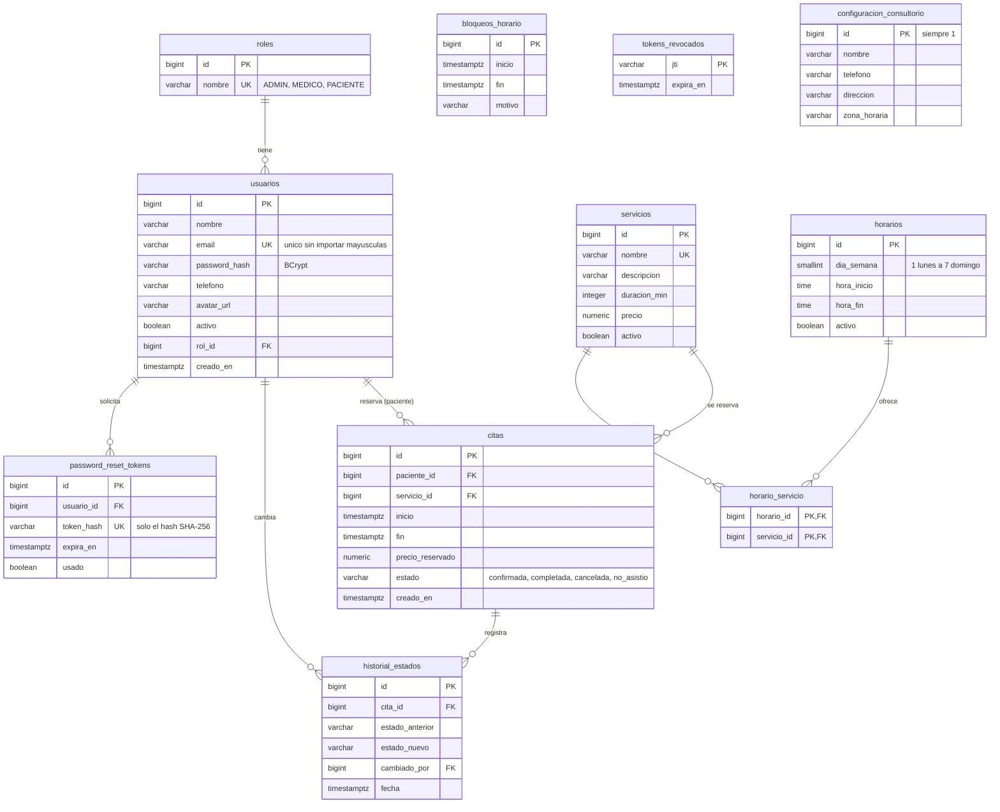

# MediCita — Equipo 02

Sistema web para la gestión de citas médicas de un consultorio. Los pacientes reservan y cancelan sus citas, el médico atiende su agenda y el administrador gestiona las cuentas y el catálogo de servicios.

## Proyecto en línea

| Recurso | Dirección |
|---|---|
| Sitio (HTTPS) | https://medicita-eq02.systems |
| URL base de la API | https://medicita-eq02.systems/api |
| Tablero de GitHub Projects | [Tablero del proyecto](https://github.com/users/AngelOxe/projects/2) |
| Prototipo de Figma | [Prototipo en Figma](https://www.figma.com/design/ec8Nn11WGY6Yyza86dSoYU/Sistema-de-citas-medicas) |

## Equipo

| Integrante | GitHub |
|---|---|
| Ángel Yibán Ruiz Osante | [AngelOxe](https://github.com/AngelOxe) |
| Karla (participó en la etapa inicial del proyecto) | [Karla-2311](https://github.com/Karla-2311) |

## Tecnologías

| Capa | Tecnología |
|---|---|
| Backend | Java 21, Spring Boot 4.1, Spring Security, Spring Data JPA, Bean Validation |
| Autenticación | JWT (jjwt), contraseñas con BCrypt |
| Base de datos | PostgreSQL 16 (motor autorizado por la profesora) |
| Migraciones | Flyway |
| Frontend | React 19, Vite, React Router 7, Axios, Tailwind CSS 4 |
| Correo | Postfix propio en el VPS con SPF, DKIM (OpenDKIM) y DMARC, enviado con JavaMailSender; el último tramo sale por un relay SMTP (ver Comunicación con el usuario) |
| SMS y WhatsApp | Twilio (API REST) |
| Pruebas de API | Bruno (35 casos, incluidos errores 400, 401, 403, 404 y 422) |
| Pruebas automáticas | JUnit 5 y Mockito |
| Despliegue | VPS en AWS EC2 (Ubuntu), nginx, systemd y Let's Encrypt (Certbot) |

## Funcionalidades por rol

| Función | Paciente | Médico | Administrador |
|---|:---:|:---:|:---:|
| Registrarse, iniciar y cerrar sesión, recuperar contraseña | Sí | Sí | Sí |
| Editar su perfil (nombre y teléfono) | Sí | Sí | Sí |
| Reservar una cita (horarios libres y ocupados) | Sí | | |
| Ver, cancelar y consultar el historial de sus citas | Sí | | |
| Dashboard: agenda del día y actividad de la semana | | Sí | |
| Dashboard: totales del consultorio | | | Sí |
| Calendario de citas por día, semana y mes | | Sí | Sí |
| Marcar una cita como completada o no asistió | | Sí | |
| Cancelar cualquier cita | | Sí | Sí |
| Servicios: crear, editar, activar, desactivar y eliminar | | Sí | Sí |
| Horarios de atención y bloqueos de agenda | | Sí | Sí |
| Usuarios: crear, editar, desactivar y eliminar cuentas | | | Sí |

Reglas de negocio principales:

- Dos citas confirmadas nunca se empalman. Se garantiza en el código, en la transacción y con una restricción `EXCLUDE` en la base de datos.
- El paciente solo cancela con 2 horas o más de anticipación.
- Un cambio de horarios no puede dejar citas futuras sin horario que las cubra.
- Solo existe un médico activo y siempre debe quedar al menos un administrador activo.
- Las cuentas y servicios con historial no se borran: se desactivan para conservar las citas.

## Estructura del repositorio

```
medicita/
├── backend/    API REST con Spring Boot
├── frontend/   Aplicación web con React
├── bruno/      Colección de pruebas de la API
├── docs/       Contrato de la API y documentación
└── deploy/     Archivos de despliegue
```

### Backend (`backend/src/main/java/com/medicita`)

| Carpeta | Responsabilidad |
|---|---|
| `controller` | Recibe las peticiones HTTP y devuelve la respuesta |
| `service` | Reglas del negocio y transacciones |
| `repository` | Consultas a la base de datos |
| `entity` | Tablas escritas como clases |
| `dto` | Formato de los JSON de entrada y salida (no se exponen las entidades) |
| `security` | Token JWT, filtro de autenticación y usuario autenticado |
| `config` | Seguridad por rol, cifrado de contraseñas y zona horaria |
| `exception` | Errores en formato JSON con el código HTTP correcto |

### Frontend (`frontend/src`)

| Carpeta | Contenido |
|---|---|
| `pages` | Una pantalla por archivo |
| `components` | Piezas reutilizables (tablas, modales, calendario, layout) |
| `services` | Llamadas a la API con Axios |
| `context`, `hooks`, `lib` | Sesión, hooks (paginación, formularios) y utilidades |

## Instalación local

Requisitos: Java 21, Node.js 20 o superior y PostgreSQL 16.

### 1. Base de datos

```sql
CREATE DATABASE medicita;
```

Las tablas y los datos de prueba se crean solos al arrancar el backend, mediante las migraciones de Flyway.

### 2. Backend

```bash
cd backend
cp src/main/resources/application.properties.example src/main/resources/application.properties
```

Edita `application.properties` con tu usuario y contraseña de PostgreSQL y una clave JWT propia (32 bytes en Base64). Este archivo no se sube al repositorio. Después:

```bash
./mvnw spring-boot:run      # en Windows: .\mvnw.cmd spring-boot:run
```

La API queda en `http://localhost:8085/api`.

### 3. Frontend

```bash
cd frontend
npm install
npm run dev
```

La aplicación queda en `http://localhost:5173`. Vite reenvía las peticiones `/api` al backend.

### 4. Pruebas

```bash
cd backend && ./mvnw test        # pruebas del backend
cd frontend && npm run lint      # revisión del frontend
```

## Cuentas de prueba

La base trae un usuario por rol, cargado desde la migración de datos de prueba (`V2__datos_semilla.sql`). Estas son las cuentas de evaluación; no afectan los datos de otros usuarios. Cualquier persona puede además crear su propio paciente desde `/registro`.

| Rol | Correo | Contraseña |
|---|---|---|
| Administrador | admin@medicita.test | Admin#2026 |
| Médico | daniel.martinez@medicita.test | Medico#2026 |
| Paciente | Crea tu propia cuenta en `/registro`, o pide al admin que la dé de alta en Usuarios. |  |

La contraseña debe tener al menos 8 caracteres, una mayúscula, un número y un carácter especial. Se valida en el frontend (debajo de cada campo) y en el backend con Bean Validation.

## API

URL base: `https://medicita-eq02.systems/api`. Las rutas protegidas reciben el token en el encabezado `Authorization: Bearer <token>`. El contrato completo está en [`docs/api-contrato.md`](docs/api-contrato.md).

| Recurso | Rutas | Acceso |
|---|---|---|
| Salud | `GET /api/salud` | Público |
| Autenticación | `POST /api/auth/register`, `/login`, `/forgot-password`, `/reset-password` | Público |
| Cerrar sesión | `POST /api/auth/logout` | Con sesión |
| Perfil | `GET`, `PUT /api/perfil` | Con sesión |
| Servicios | `GET /api/servicios` | Con sesión |
| Servicios | `POST`, `PUT`, `DELETE /api/servicios/{id}` | Administrador y médico |
| Horarios y bloqueos | `/api/horarios`, `/api/bloqueos` | Administrador y médico |
| Disponibilidad | `GET /api/disponibilidad?servicioId=&fecha=` | Con sesión |
| Citas | `POST /api/citas` | Con sesión |
| Citas del paciente | `GET /api/citas/mias` | Paciente |
| Agenda completa | `GET /api/citas` (filtros, rango y paginación) | Administrador y médico |
| Cancelar cita | `PATCH /api/citas/{id}/cancelar` | Con sesión |
| Cambiar estado | `PATCH /api/citas/{id}/estado` | Médico |
| Usuarios | `/api/usuarios` | Administrador |
| Dashboard | `GET /api/dashboard/resumen` | Administrador y médico |

Las listas usan paginación y filtros del servidor (`?page=&size=&search=...`). Los errores devuelven JSON con `status`, `message`, `path` y `fieldErrors`, con los códigos 400, 401, 403, 404, 409, 422 y 500.

## Base de datos

PostgreSQL con 11 tablas versionadas con Flyway (`backend/src/main/resources/db/migration`):

| Migración | Contenido |
|---|---|
| `V1__esquema_base.sql` | Tablas, índices y la restricción que impide citas empalmadas |
| `V2__datos_semilla.sql` | Datos de prueba: roles, usuarios de cada rol, servicios, horarios, bloqueos y citas |
| `V3__telefonos_validos.sql` | Cambia los teléfonos de prueba por números ficticios con formato internacional |
| `V4__bloqueos_y_limpieza.sql` | Completa los datos de prueba hasta 10 bloqueos futuros y elimina tokens vencidos |

Tablas: `roles`, `usuarios`, `servicios`, `horarios`, `horario_servicio` (relación N:M entre horarios y servicios), `bloqueos_horario`, `citas`, `historial_estados`, `configuracion_consultorio`, `password_reset_tokens` y `tokens_revocados`.

- Respaldo de la base en SQL (esquema y datos): [`docs/medicita_respaldo.sql`](docs/medicita_respaldo.sql)

### Diagrama entidad-relación



`bloqueos_horario`, `tokens_revocados` y `configuracion_consultorio` no tienen llaves foráneas: son datos independientes. Dos citas confirmadas no pueden empalmarse gracias a la restricción `EXCLUDE USING gist` de la tabla `citas`.

## Seguridad

- Contraseñas con BCrypt; nunca se guardan en texto plano.
- Autenticación con JWT sin sesiones en el servidor. El cierre de sesión revoca el token.
- Permisos por rol en el backend (Spring Security) y rutas protegidas por rol en React.
- Recuperación de contraseña con token de un solo uso que vence a los 30 minutos; solo se guarda su hash.
- Claves y credenciales en `application.properties` (fuera del repositorio) o en variables de entorno del servidor. El repositorio incluye `application.properties.example` sin valores reales.
- HTTPS con certificado de Let's Encrypt.

## Comunicación con el usuario

| Canal | Estado |
|---|---|
| Correo (recuperación de contraseña, confirmación y cancelación de cita) | Postfix propio en el VPS, con firma DKIM (OpenDKIM), SPF y DMARC en el DNS del dominio |
| SMS | Twilio, desde el backend (`TwilioService`) |
| WhatsApp | Twilio, desde el backend (`TwilioService`) |

Notas sobre estos servicios:

- **Correo:** el backend entrega el mensaje al Postfix local, que lo firma con DKIM. AWS bloquea el puerto 25 de salida en cuentas nuevas y rechazó la solicitud para desbloquearlo, así que Postfix reenvía el último tramo por el puerto 587 a un relay SMTP (Resend). El servidor de correo, la firma DKIM y los registros SPF, DKIM y DMARC son propios y del dominio del proyecto; el relay solo es el último salto de entrega, y el backend nunca usa una API de terceros para enviar.
- **SMS y WhatsApp:** se envían al reservar o cancelar una cita. La cuenta de Twilio es de prueba, por lo que solo permite plantillas fijas y números verificados. Si Twilio o el correo fallan, el error se registra y la reserva continúa.
- Todos los envíos se activan con variables de entorno del servidor y vienen apagados por defecto.

## Despliegue

Todo corre en un VPS propio (AWS EC2, Ubuntu):

- Backend: archivo JAR administrado por `systemd`, con las claves en un archivo de variables fuera del repositorio.
- Frontend: compilación estática (`npm run build`) servida por nginx, que también reenvía `/api` al backend.
- Base de datos: PostgreSQL en el mismo servidor, sin acceso desde Internet.
- HTTPS: certificado de Let's Encrypt con Certbot, con renovación automática.

## Diseño

Prototipo y diseño en Figma: [ver prototipo](https://www.figma.com/design/ec8Nn11WGY6Yyza86dSoYU/Sistema-de-citas-medicas).

### Logo


El logo es un calendario con una cruz médica en el centro: el calendario representa la reserva de citas, núcleo de la aplicación, y la cruz remite de forma directa al ámbito médico. Es un diseño propio del equipo, hecho en SVG, y se usa tanto en la pantalla de inicio de sesión como en el ícono de la pestaña del navegador (`frontend/public/favicon.svg`).

### Paleta de colores

La paleta se construyó alrededor de un solo matiz, el azul, en distintos tonos de saturación y luminosidad (una paleta monocromática con acentos semánticos):

| Color | Valor | Uso | Por qué |
|---|---|---|---|
| Azul de marca | `#0284c7` | Botones primarios, enlaces, elementos activos | El azul es el color que más se asocia con la confianza, la calma y la profesionalidad en entornos de salud; por eso lo usan la mayoría de los sistemas médicos y bancarios. |
| Azul oscuro (menú) | `#164e63` / `#0c3c51` | Barra lateral, panel del login | Un azul casi marino, más oscuro y desaturado, para dar estabilidad visual a la navegación sin competir con el contenido. |
| Azules claros | `#f0f9ff`, `#e0f2fe`, `#bae6fd` | Fondos de tarjetas activas, resaltados | Tintes muy claros del mismo matiz: aportan jerarquía (qué está seleccionado) sin introducir un color distinto, manteniendo la armonía monocromática. |
| Gris neutro | `#f8fafc`, `#e2e8f0`, `#64748b`, `#0f172a` | Fondo general, bordes, texto | Grises con una leve temperatura fría, coherentes con el azul, para que el texto y los espacios en blanco no rompan la paleta. |
| Verde / ámbar / rojo | `#15803d`, `#b45309`, `#dc2626` | Estados de la cita (confirmada, pendiente, cancelada) | Son los únicos colores fuera del azul: se usan solo como código de estado (semáforo), porque ahí sí hace falta que un color distinto llame la atención de inmediato. |

Mantener casi toda la interfaz en un solo matiz reduce la carga visual en pantallas con mucha información (tablas de citas, horarios, listas de usuarios) y dirige la vista del usuario hacia los tres colores de estado, que son los que de verdad necesita distinguir rápido.

## Pruebas de API con Bruno

La colección está en la carpeta [`bruno/`](bruno), con 35 solicitudes y sus pruebas automáticas. Cubre el registro, el inicio de sesión de los tres roles con su token JWT, servicios, disponibilidad, reserva y cancelación de citas, horarios, usuarios y el dashboard. Incluye casos de error a propósito: datos inválidos (400), sin token o credenciales incorrectas (401), permisos por rol (403), recursos inexistentes (404) y reglas del negocio como horario ocupado o fecha pasada (422).

Para ejecutarla, abre la carpeta en Bruno, elige el entorno `Local` y escribe en él las contraseñas de `adminPassword` y `medicoPassword` (son variables secretas que no se guardan en el repositorio). Con la CLI: `bru run --env Local --env-var adminPassword=... --env-var medicoPassword=...`.

## Organización del trabajo

- Ramas por tarea (`feature/...`) integradas a `main` mediante Pull Requests.
- Commits con mensajes descriptivos del avance real.
- Tablero de GitHub Projects con las columnas Backlog, To Do, In Progress, In Review y Done: [ver tablero](https://github.com/users/AngelOxe/projects/2).
